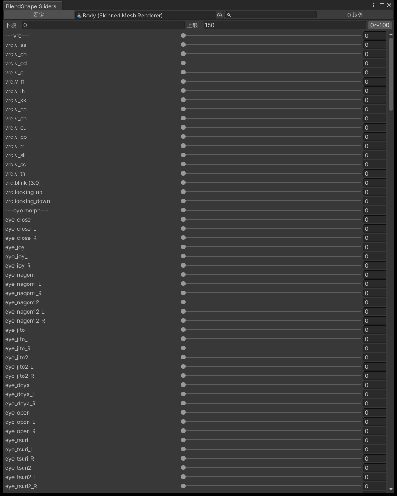

# ブレンドシェイプのスライダー

Unity の Inspector では、ブレンドシェイプのスライダーの範囲はメッシュで決まっていて（多くは 0〜100）、変えられません。BlendShape Sliders のウィンドウでは、スライダーの下限と上限を決めてブレンドシェイプを動かせます。100 を超える値を入れたいときや、狭い範囲で細かく動かしたいときに使います。

Inspector の BlendShapes の欄はそのままです。どちらで変えても同じ値が入ります。

{ .shot loading=lazy }

## 開き方

| 開き方 | 対象 |
|---|---|
| `Tools > Poyo's Editor Toolbox > BlendShape Sliders` | 選んでいるオブジェクト |
| SkinnedMeshRenderer のコンポーネントのメニュー（⋮）の `BlendShape Sliders` | その SkinnedMeshRenderer に固定します |
| Project Settings の `ウィンドウを開く` | 選んでいるオブジェクト |

## 画面

| 項目 | 内容 |
|---|---|
| `固定` | ON にすると、ほかのオブジェクトを選んでも対象が変わりません |
| 対象の欄 | 今の対象です。SkinnedMeshRenderer をドロップすると、それに固定します |
| 検索欄 | 名前の一部で絞り込みます。大文字と小文字は区別しません |
| `0 以外` | 値が 0 ではないブレンドシェイプだけを出します |
| `下限` / `上限` | スライダーの範囲です |
| `0〜100` | 範囲を 0〜100 に戻します |

範囲はプロジェクトに保存し、Project Settings の範囲と同じ値です。下限と上限は、1 以上離れるように自動で直します。

数値欄にも、範囲の外の値は入れられません。範囲の外にある今の値は、スライダーが端に寄って表示されるだけで、触らなければ変わりません。

## Undo・Prefab・アニメーション

Inspector で変えたときと同じです。

- Undo で取り消せます。
- Prefab インスタンスでは Overrides に残ります。
- Animation ウィンドウで録画しているときに動かすと、キーが打たれます。

## 0〜100 の外の値が反映されない

Player Settings の Clamp BlendShapes がオンのときは、Unity が値を 0〜100 に収めます。この状態で範囲を 0〜100 の外にすると、ウィンドウに注意が出ます。
