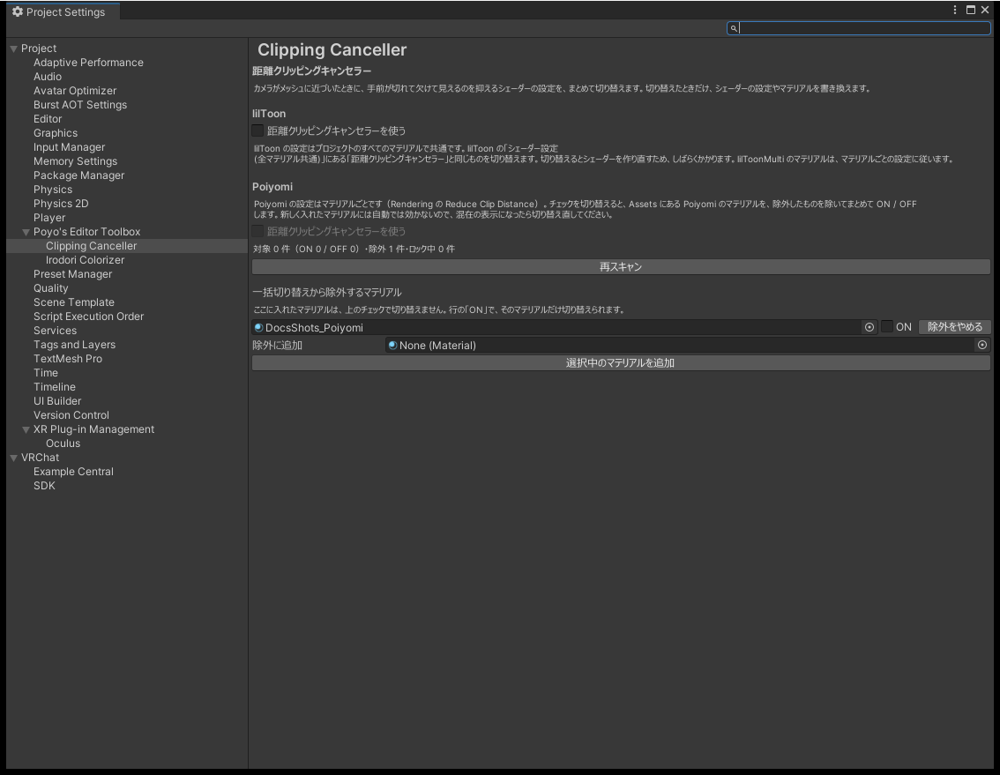

# 距離クリッピングキャンセラー

カメラがメッシュに近づくと、手前が切れて欠けて見えることがあります。lilToon と Poiyomi には、これを抑える「距離クリッピングキャンセラー」の設定があります。このページでは、その設定をプロジェクトのマテリアルにまとめて切り替えます。

lilToon と Poiyomi では設定の持ち方が違うので、ページの中で節が分かれています。

| シェーダー | 設定の範囲 | 必要なもの |
|---|---|---|
| lilToon | プロジェクトのすべてのマテリアルで共通 | lilToon 2.0.0 以上、3.0.0 未満 |
| Poiyomi | マテリアルごと | Poiyomi のシェーダー。ロック中のマテリアルを変えるには ThryEditor 2.74.3 以上、3.0.0 未満 |

ほかの機能と違い、オン・オフの項目はありません。チェックを切り替えたときだけ、シェーダーの設定やマテリアルを書き換えます。

{ .shot loading=lazy }

## 開き方

- `Edit > Project Settings > Poyo's Editor Toolbox > Clipping Canceller`
- Project Settings の `Poyo's Editor Toolbox` のページにある `距離クリッピングキャンセラーの設定を開く`

## lilToon

`距離クリッピングキャンセラーを使う` を切り替えます。lilToon の設定画面の「シェーダー設定 (全マテリアル共通)」にある「距離クリッピングキャンセラー」と同じ設定です。どちらで変えても同じ値になります。

1. `距離クリッピングキャンセラーを使う` を押します。
2. 確認が出たら `切り替える` を押します。
3. lilToon のシェーダーを作り直し、そのあとスクリプトを再読み込みします。終わるまでしばらくかかります。

設定は `ProjectSettings/lilToonSetting.json` に保存され、このプロジェクトのすべての lilToon のマテリアルに効きます。lilToonMulti のマテリアルは、マテリアルごとの設定に従います。

| 表示 | 内容 |
|---|---|
| チェックが灰色で「lilToon 2.0.0 以上を VCC などで入れているときに使えます。」 | lilToon が入っていないか、対応していないバージョンです |
| 「lilToon の設定がロックされているため切り替えられません。」 | lilToon の設定画面でロックを外してください |
| 「lilToon の設定ファイル（ProjectSettings/lilToonSetting.json）を読み取れませんでした。」 | `Assets > lilToon > [Shader] Refresh shaders` を一度実行すると作られます。そのあと `再読み込み` を押してください |
| 「lilToon の設定は書き換えましたが、シェーダーを作り直せませんでした。」 | `Assets > lilToon > [Shader] Refresh shaders` を実行してください |

Play モードの間は切り替えられません。

## Poiyomi

Poiyomi では、マテリアルの Rendering にある Reduce Clip Distance が距離クリッピングキャンセラーです。`距離クリッピングキャンセラーを使う` を切り替えると、`Assets` にある Poiyomi のマテリアルをまとめて ON か OFF にします。

1. `距離クリッピングキャンセラーを使う` を押します。
2. 確認に、変わるマテリアルの数が出ます。`切り替える` を押します。

次のものは変えません。

- 除外リストに入れたマテリアル
- 親の値に従っている Material Variant（親と一緒に変わります）
- `Packages/` の中のマテリアルと、FBX などのモデルの中のマテリアル

チェックの状態は、対象のマテリアルがすべて ON ならチェック、すべて OFF なら空です。ON と OFF が混ざっているときは混在の表示になり、押すとすべて ON にします。

新しく入れたマテリアルには自動で効きません。混在の表示になったら、もう一度切り替えてください。

Undo では戻せません。もう一度切り替えると、すべてそろいます。切り替える前に ON と OFF が混ざっていたときは、その組み合わせには戻せません。

### 件数の表示

チェックの下に、次の件数が出ます。

| 項目 | 内容 |
|---|---|
| 対象 | まとめて切り替えるマテリアルの数と、そのうち ON と OFF の数 |
| 除外 | 除外リストに入れたマテリアルの数 |
| ロック中 | 対象のうち、ロック（Lock In）しているマテリアルの数 |
| 親の値に従う Variant | 親の値に従っていて、切り替えない Material Variant の数。1 件以上あるときだけ出ます |

件数はページを開いたときに数えます。ページを開いたまま、マテリアルの Inspector で ON・OFF を切り替えたときは、件数にもすぐに反映します。マテリアルを足したり消したりしたあとは、`再スキャン` を押してください。

### ロック中のマテリアル

ロックしたマテリアルは、値を書き込んだシェーダーを使っているので、値だけ変えても見た目は変わりません。ThryEditor 2.74.3 以上が入っているときは、ロックを解除してから変えます。解除したままになりますが、アップロードするときに Poiyomi が自動でロックし直します。

ThryEditor が無いか、対応していないバージョンのときは、ロック中のマテリアルは変えません。Poiyomi のロックを解除してから、もう一度切り替えてください。

### 除外リスト

`一括切り替えから除外するマテリアル` に入れたマテリアルは、上のチェックで切り替えません。ほかと違う設定にしておきたいマテリアルを入れます。

| 項目 | 内容 |
|---|---|
| 行の `ON` | そのマテリアルだけを切り替えます。確認は出ません |
| 行の `除外をやめる` | 除外リストから外します。マテリアルの値は変えません |
| `除外に追加` | マテリアルをドロップすると、除外リストに入れます |
| `選択中のマテリアルを追加` | Project ウィンドウで選んでいるマテリアルを、まとめて除外リストに入れます |

入れられるのは、`Assets` にある `.mat` の Poiyomi のマテリアルだけです。それ以外を入れようとすると、入れなかった理由が出ます。

ロック中のマテリアルの行は、ThryEditor が無いときは `ON` を押せず、「ロック中」と出ます。

除外したマテリアルを消すと、行が「（見つかりません） 」と GUID の表示になります。要らなければ `除外をやめる` で外してください。

除外リストは `ProjectSettings/EditorToolbox.asset` に保存されます。Git などで共有できます。
