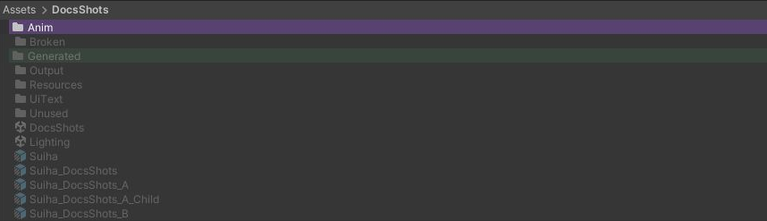

# 色で絞り込む

Project ウィンドウで、選んだ色のラベルが付いたものだけを目立たせます。ほかの行は暗くなります（行は消えません）。

{ .shot loading=lazy }

## 使い方

1. Project ウィンドウで右クリックし、`Poyo's Editor Toolbox > Filter by Label…` を選びます。
2. ラベルの一覧で、絞り込む色にチェックを入れます。いくつでも選べます。

チェックを入れるとすぐに表示が変わります。一覧の外をクリックすると一覧は閉じますが、絞り込みは続きます。

暗くならないのは、次の行です。いくつかの色を選んだときは、どれか 1 つに当てはまれば暗くなりません。

- 選んだ色のラベルが付いたフォルダとアセット
- 選んだ色のラベルが付いたフォルダの中身
- それらの親のフォルダ（`Assets` まで）

リスト表示、アイコン表示、左のフォルダのツリーのどれでも使えます。絞り込んでいる間にラベルを付けたり外したりすると、表示もすぐに変わります。

## やめる

右クリックの `Poyo's Editor Toolbox > Clear Label Filter` か、一覧の下の `すべて解除` でやめます。Unity を閉じたときもやめます。スクリプトの再コンパイルではやめません。

## 選べないとき

`Filter by Label…` が灰色のときは、[設定画面](settings.md)の「Irodori Colorizer を使う」と、[Irodori Colorizer の設定](colorizer-settings.md)の「Project ウィンドウ」がオンかを確かめてください。
