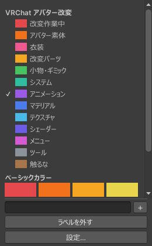

# プリセット

プリセットは、用途ごとにまとめたラベルの組です。3 つ入っていて、設定画面の「プリセット」で組ごとにオン・オフできます。

| プリセット | ラベルの数 | 最初 | 用途 |
|---|---|---|---|
| VRChat アバター改変 | 13 | オン | アバター改変のプロジェクト |
| ベーシックカラー | 16 | オン | 色の意味を自分で決めたいとき |
| 汎用 Unity プロジェクト | 12 | オフ | ゲーム制作などのプロジェクト |

{ .shot loading=lazy }

## VRChat アバター改変

| ラベル | 対象の例 |
|---|---|
| 改変作業中 | 編集している Prefab Variant、作業用のフォルダ |
| アバター素体 | 素体の配布物 |
| 衣装 | 衣装のアセット |
| 改変パーツ | 髪・目・アクセサリーなどの差し替えるパーツ |
| 小物・ギミック | 持ち物、トグルで出し入れするもの |
| システム | ごろ寝など、大きめのギミック |
| アニメーション | AnimationClip、Animator Controller |
| マテリアル | マテリアルとその複製 |
| テクスチャ | 画像 |
| シェーダー | シェーダー |
| メニュー | メニューとメニューのアイコン |
| ツール | アバターに入れないエディタ拡張 |
| 触るな | インポートしたまま書き換えない配布物 |

配布物を直接書き換えないように、「改変作業中」と「触るな」を対にして使うのがおすすめです。

## ベーシックカラー

意味を決めていない 16 色です。名前は色の名前です（Red、Orange、Amber、Yellow、Lime、Green、Emerald、Teal、Cyan、Blue、Indigo、Violet、Magenta、Pink、Brown、Gray）。名前を書き換えて使えます。

## 汎用 Unity プロジェクト

Scenes、Scripts、Prefabs、Materials、Textures、Models、Animations、Audio、Shaders、UI、Editor、ThirdParty の 12 個です。最初はオフです。

## オフにしたとき

- プリセットをオフにすると、そのラベルは一覧から消え、行の色も出なくなります。
- 付けた色の記録は残ります。オンに戻すと、元の色が出ます。
- ラベルを 1 つずつ非表示にしたときも同じです。
- オフのプリセットのラベルを付けた行があるときは、設定画面にその数が出ます。

要らないラベルは、組ごとならプリセットをオフに、いくつかだけなら設定画面の「ラベル一覧」で非表示にします。名前や色は設定画面で変えられます（[Irodori Colorizer の設定](colorizer-settings.md)）。
