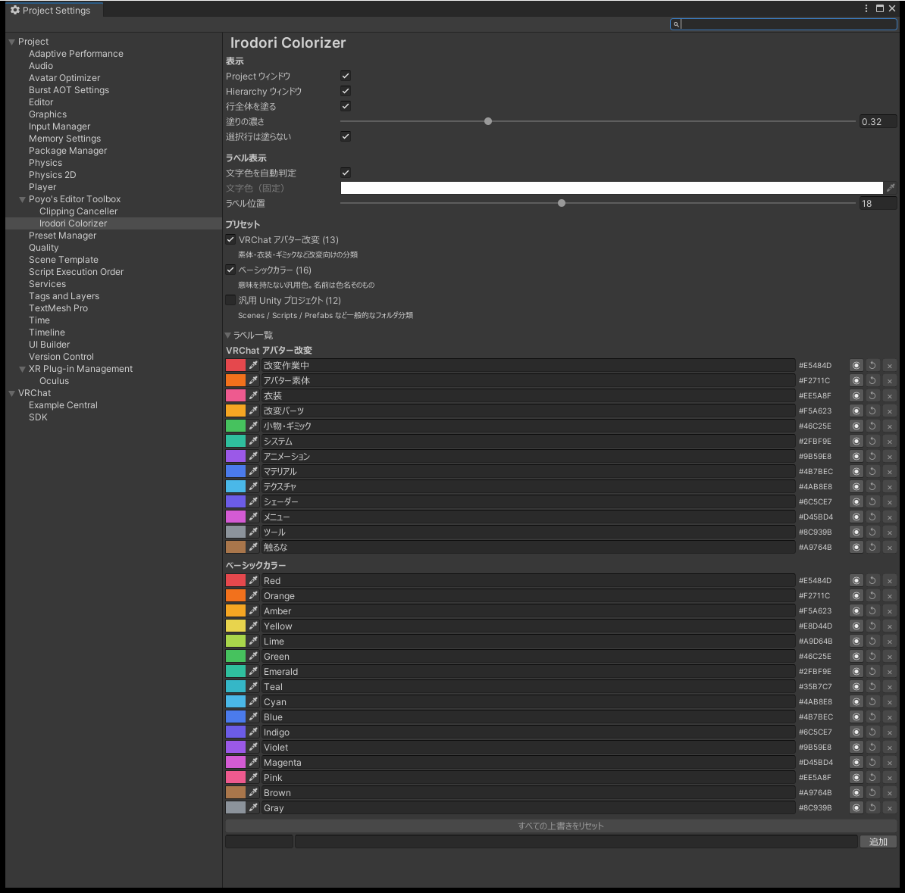

# Irodori Colorizer の設定

`Edit > Project Settings > Poyo's Editor Toolbox > Irodori Colorizer` で開きます。ラベルの一覧の `設定…` や、Project Settings の `Poyo's Editor Toolbox` のページの `Irodori Colorizer の設定を開く` からも開けます。

変えた値はその場で保存し、Project ウィンドウと Hierarchy にすぐ反映します。

{ .shot loading=lazy }

Irodori Colorizer 全体のオン・オフは、[設定画面](settings.md)の「Irodori Colorizer を使う」で切り替えます。オフにすると、色付け、ラベルの右クリックのメニュー、色での絞り込みが止まり、このページの項目は灰色になります。付けた色の記録は残ります。

## 表示

| 項目 | 内容 |
|---|---|
| Project ウィンドウ | Project ウィンドウに色を付けるか |
| Hierarchy ウィンドウ | Hierarchy に色を付けるか |
| 行全体を塗る | オフにすると、アイコンと名前のまわりだけに色を付けます |
| 塗りの濃さ | 色の不透明度です。色が目立ちすぎるときは下げます |
| 選択行は塗らない | 選んでいる行には色を付けず、Unity の選択の色を出します |

「Project ウィンドウ」をオフにすると、[色での絞り込み](colorizer-filter.md)も使えなくなります。

## ラベル表示

| 項目 | 内容 |
|---|---|
| 文字色を自動判定 | 色の明るさに合わせて、文字を白か黒にします |
| 文字色（固定） | 自動判定をオフにしたときの文字の色です。明るい色の行では読みにくくなることがあります |
| ラベル位置 | 文字の位置を、数ピクセル単位で直します |

## プリセット

プリセットごとのオン・オフです。行ごとにラベルの数と説明が出ます（[プリセット](colorizer-presets.md)）。

- オフのプリセットのラベルを付けた行があると、その数が出ます。そのままでかまいません。
- 「対応するラベルが見つからない ID の割り当て」と出ることがあります。削除したラベルを付けていた行の記録です。表示には使わないので、そのままでかまいません。

## ラベル一覧

オンのプリセットのラベルが、プリセットごとに並びます。

| 表示 | 操作 |
|---|---|
| 色 | ラベルの色を変えます |
| 名前 | ラベルの名前を変えます |
| カラーコード | 選んでコピーできます |
| ◉ / ◎ | ラベルを非表示にします / 表示に戻します |
| ↺ | ラベルを最初の色と名前に戻します |
| × | 自分で作ったラベルを削除します |

- 一覧の下の `すべての上書きをリセット` を押すと、入っているラベルの色・名前・非表示をすべて最初の状態に戻します。確認のダイアログが出ます。自分で作ったラベルと、付けた色の記録は消えません。
- いちばん下の入力欄で、カラーコードと名前を入れてラベルを作れます。
- 自分で作ったラベルを削除すると、そのラベルを付けた行の色は出なくなります。確認のダイアログが出ます。

## 保存先

設定と、どこに何色を付けたかは `ProjectSettings/EditorToolbox.IrodoriColorizer.asset` に保存します。このファイルを Git などで共有すると、同じプロジェクトを開いた人にも同じ色が付きます。
