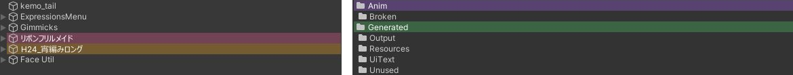

# Irodori Colorizer

Project ウィンドウと Hierarchy の行に、色のラベルを付けます。配布物のフォルダや作業中の Prefab などを、色で見分けられます。

{ .shot loading=lazy }

## メニュー

右クリックのメニューの `Poyo's Editor Toolbox` の下にあります。

| 場所 | 項目 | 動き |
|---|---|---|
| Project ウィンドウ | `Set Label…` | ラベルの一覧を開いて、色を付けます |
| Project ウィンドウ | `Clear Label` | 色を外します |
| Project ウィンドウ | `Filter by Label…` / `Clear Label Filter` | 色で絞り込みます / 絞り込みをやめます（[色で絞り込む](colorizer-filter.md)） |
| Hierarchy | `Set Label…` | ラベルの一覧を開いて、色を付けます |
| Hierarchy | `Clear Label` | 色を外します |

## 色を付ける

1. 色を付けるフォルダやアセット（Project ウィンドウ）か、GameObject（Hierarchy）を右クリックします。
2. `Poyo's Editor Toolbox > Set Label…` を選びます。
3. ラベルの一覧で、ラベルをクリックします。

クリックするとすぐに行に色が付きます。いくつか選んだまま右クリックすると、選んだものすべてに同じラベルが付きます。

Prefab ではない GameObject に色を付けるときは、先にシーンを保存してください。保存していないシーンでは付けられません。Prefab インスタンスのルートは、保存していなくても付けられます（[色の付き方](colorizer-behavior.md)）。

## ラベルの一覧

一覧は、オンにしたプリセットごとに見出しで分かれています。

| 表示 | 内容 |
|---|---|
| 色とラベル名 | クリックすると、そのラベルを付けます |
| ✔ | 選んでいるものに、そのラベルが付いています |
| いちばん下の入力欄と `＋` | カラーコードからラベルを作り、そのまま付けます |
| `ラベルを外す` | 選んでいるものからラベルを外します |
| `設定…` | [Irodori Colorizer の設定](colorizer-settings.md)を開きます |

一覧に何も出ないときは、プリセットがすべてオフです（[プリセット](colorizer-presets.md)）。

## 色を外す

右クリックの `Poyo's Editor Toolbox > Clear Label` か、ラベルの一覧の `ラベルを外す` で外します。

シーンの Prefab インスタンスの色は、元の Prefab アセットに付いています。外すと、Project ウィンドウと、シーンのほかのインスタンスからも色が消えます。このときは確認のダイアログが出ます。

## ラベルを作る

ラベルの一覧のいちばん下か、設定画面の「ラベル一覧」のいちばん下で作れます。

1. カラーコードを入れます。`#RRGGBB`、`#RRGGBBAA`、`red` のような色の名前を使えます。
2. `＋`（設定画面では `追加`）を押します。

名前を空にすると、カラーコードが名前になります。名前は設定画面で変えられます。削除できるのは、自分で作ったラベルだけです。

ラベルの色や名前を変えても、そのラベルを付けた行はそのままです。設定画面でラベルの色を変えると、そのラベルを付けた行の色がすべて変わります。

## 付かないところ

- Prefab の編集モードで開いた中身には、シーン用の色は付きません。
- Prefab に付けた色は、子のオブジェクトには付きません。ルートだけに付きます。

## 単体版の Irodori Colorizer が入っているとき

単体版の Irodori Colorizer が入っている間は、このパッケージの色付けを止めます。Console と設定画面に、単体版を削除するよう案内が出ます。単体版を削除すると、`ProjectSettings/IrodoriColorizer.asset` の色と設定を `ProjectSettings/EditorToolbox.IrodoriColorizer.asset` に写して使います。元のファイルは消しません。
