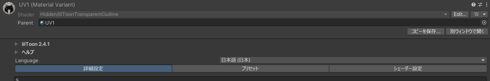

# コピーを保存

Unity の「複製（Ctrl+D）」は、同じフォルダにしかコピーを作れません。この機能をオンにすると、アセットの Inspector のヘッダーの右下に `コピーを保存…` ボタンが出ます。保存先と名前を選んで、コピーを 1 回で作れます。

{ .shot loading=lazy }

## 使い方

1. Project ウィンドウで、コピーするアセットを選びます。
2. Inspector の `コピーを保存…` を押します。
3. 保存のダイアログで、保存先のフォルダと名前を選んで保存します。

コピーができると、Project ウィンドウでそのアセットが強調表示されます。選んでいるアセットは元のままです。

| 項目 | 最初の値 |
|---|---|
| 保存先 | 元のアセットと同じフォルダ。`Packages/` の中のアセットのときは `Assets` |
| 名前 | 元の名前に番号を付けたもの（例: `Base 1.mat`） |

`Packages/` の中のマテリアルは、編集できなかったり、パッケージを更新すると元に戻ったりします。`Assets/` にコピーすれば、自分で編集できます。

[Inspector を別ウィンドウで開く](inspector.md)もオンのときは、ボタンが `コピーを保存…`、`別ウィンドウで開く` の順に並びます。

## ボタンが出ないもの

- フォルダ
- シーンに置いた GameObject
- FBX の中のマテリアルやメッシュなど、ほかのアセットの中にあるもの
- 2 つ以上選んでいるとき

## 注意

- 同じ名前のファイルがあるときは、コピーしません。保存のダイアログで上書きを選んでも、上書きせずに理由を表示します。上書きすると、そのアセットを使っているマテリアルや Prefab との対応が崩れることがあるためです。
- コピーは Undo で取り消せません。要らなくなったら、Project ウィンドウで削除してください。
