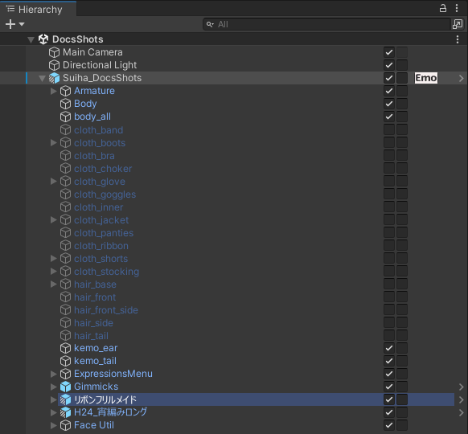

# Hierarchy のチェックボックス

Hierarchy の GameObject の行の右端に、チェックボックスを 2 つ出します。Inspector を開かずに、表示と EditorOnly を切り替えられます。

| 位置 | 項目 | チェックを入れると | 外すと |
|---|---|---|---|
| 左 | 表示（Active） | 表示します | 非表示にします |
| 右 | EditorOnly | タグを `EditorOnly` にします。アップロードに含まれなくなります | タグを `Untagged` にします |

チェックボックスにマウスを乗せると、どちらの項目かが出ます。

{ .shot loading=lazy }

- いくつかの GameObject を選んだまま、選んだ行のチェックボックスを押すと、選んだものすべてが同じ値になります。選んでいない行のチェックボックスを押すと、その行だけが変わります。
- チェックボックスを押しても、選択は変わりません。
- 切り替えは Undo で取り消せます。Prefab インスタンスで切り替えたときは、Inspector の Overrides に変更として残ります。

## EditorOnly が押せない行

タグが `Untagged` と `EditorOnly` 以外の行では、EditorOnly のチェックボックスが灰色になり、押せません。EditorOnly を外すとタグが `Untagged` になり、元のタグがなくなってしまうためです。いくつか選んでまとめて切り替えたときも、この行は変わりません。

## 位置

既定では、行の右端から 56px 空けて並べます。右端には、Prefab を開く「>」のボタンや、ほかの拡張のボタンが出ることが多いためです。

ほかの拡張のボタンと重なるときは、Project Settings の「右端からの距離」（0〜200px）で動かしてください。値を大きくすると左に寄ります。名前の長い行では、名前の上にチェックボックスが重なります。気になるときは Hierarchy の幅を広げてください。
