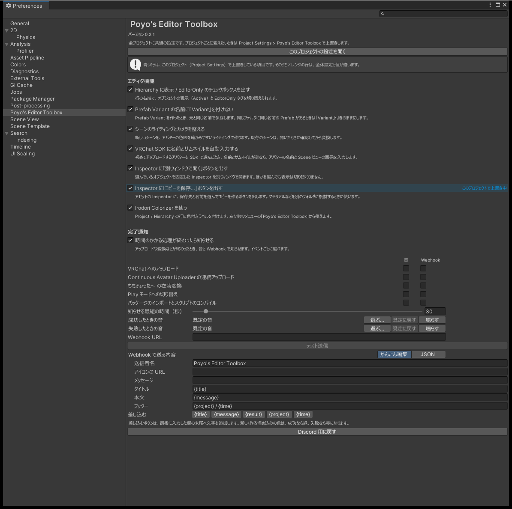

# はじめに

Poyo's Editor Toolbox は、VRChat のアバター改変で使う Unity エディタを少し使いやすくする機能をまとめたパッケージです。機能ごとにオン・オフできます。

## 機能の一覧

| 機能 | 内容 |
|---|---|
| [Hierarchy のチェックボックス](hierarchy.md) | Hierarchy の行の右端で、表示（Active）と EditorOnly を切り替える |
| [Prefab Variant の名前](variant.md) | Variant を作ったとき、名前の末尾に「Variant」を付けない |
| [シーンのライティング](scene-lighting.md) | アバターの色を確かめやすいライティングでシーンを作る |
| [VRChat SDK への自動入力](sdk-autofill.md) | 初めてアップロードするアバターの名前とサムネイルを入れる |
| [Inspector を別ウィンドウで開く](inspector.md) | 選んだオブジェクトに固定した Inspector を、別のウィンドウで開く |
| [コピーを保存](copy-asset.md) | 保存先と名前を選んで、アセットのコピーを作る |
| [ブレンドシェイプのスライダー](blendshape-sliders.md) | 下限と上限を決めたスライダーで、ブレンドシェイプを動かす |
| [完了通知](notifications.md) | アップロードやインポートが終わったら、音と Webhook で知らせる |
| [距離クリッピングキャンセラー](clipping-canceller.md) | lilToon と Poiyomi の距離クリッピングキャンセラーを、まとめて切り替える |
| [Irodori Colorizer](colorizer.md) | Project と Hierarchy の行に色のラベルを付ける |

入れた直後は、どの機能もオフです。[設定画面](settings.md)で使う機能をオンにしてください。オン・オフは PC のすべてのプロジェクトで共通にでき、プロジェクトごとに変えることもできます。距離クリッピングキャンセラーにはオン・オフが無く、専用のページで切り替えたときだけ動きます。

{ .shot loading=lazy }

## 共通の動き

- アバターやシーンに独自のコンポーネントを追加しません。すべてエディタ専用です。
- 設定は Unity のエディタ設定、`ProjectSettings/`、`UserSettings/` に保存します。`Assets/` にはファイルを作りません。
- 自動で出る確認のウィンドウは、エディタの操作を止めません。
- 値の変更は、ほとんどが Undo で取り消せます。取り消せないものは各ページに書いています。

## スクリーンショットについて

このドキュメントのスクリーンショットには、次のアセットを使っています。

| 種類 | アセット | 配布ページ |
|---|---|---|
| アバター | Suiha | <https://dockyard.booth.pm/items/7534638> |
| 衣装 | 白凪館のリボンフリルメイド | <https://387.booth.pm/items/8995256> |
| 髪 | H24_宵編みロング | <https://kiriha-astra.booth.pm/items/7773808> |
