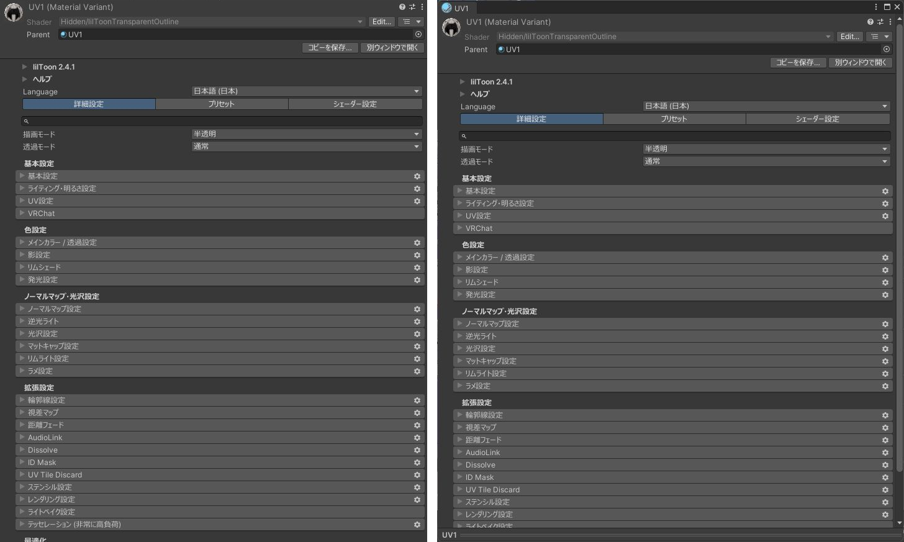

# Inspector を別ウィンドウで開く

Inspector は、ほかのオブジェクトを選ぶと表示が変わります。この機能をオンにすると、Inspector のヘッダー（名前・Tag・Layer の欄）の右下に `別ウィンドウで開く` ボタンが出ます。押すと、そのオブジェクトに固定した Inspector が別のウィンドウで開きます。

{ .shot loading=lazy }

## 使い方

1. オブジェクトを選びます。
2. Inspector の `別ウィンドウで開く` を押します。

開いたウィンドウは、ほかのものを選んでも表示が変わりません。ロックの操作は要りません。

- ウィンドウはいくつでも開けます。2 つのオブジェクトを並べて見比べられます。
- 開いたウィンドウで値を変えると、元のオブジェクトに入ります。Undo も使えます。
- GameObject を開くとすべてのコンポーネントが、マテリアルなどのアセットを開くとそのアセットが表示されます。
- ボタンは、1 つだけ選んでいるときに出ます。
