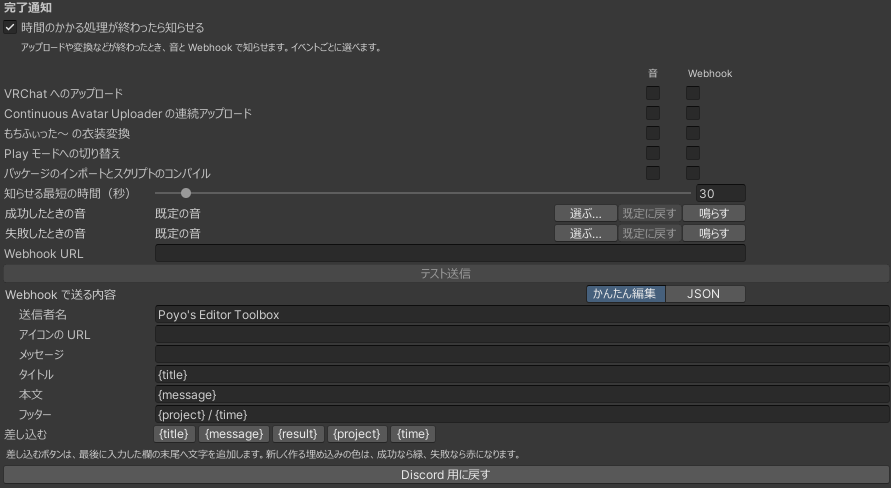

# 完了通知

アップロードやパッケージのインポートなど、時間のかかる処理が終わったときに、音と Webhook で知らせます。

設定画面の下の「完了通知」で設定します。最初はオフです。「時間のかかる処理が終わったら知らせる」をオンにすると使えます。

{ .shot loading=lazy }

## 知らせる処理

処理ごとに、音と Webhook をそれぞれオン・オフできます。表の「音」と「Webhook」は最初の状態です。

| 処理 | 知らせるとき | 音 | Webhook |
|---|---|---|---|
| VRChat へのアップロード | VRChat SDK でのアップロードが成功・失敗したとき。ビルドに失敗したときも知らせます | オン | オン |
| Continuous Avatar Uploader の連続アップロード | 連続アップロードがすべて終わったとき | オン | オン |
| もちふぃった～ の衣装変換 | 変換が終わり、出力の Prefab ができたとき | オン | オン |
| Play モードへの切り替え | Play モードに入るのに時間がかかったとき | オン | オフ |
| パッケージのインポートとスクリプトのコンパイル | `.unitypackage` のインポートやコンパイルに時間がかかったとき | オン | オフ |

「VRChat へのアップロード」には VRChat SDK 3.10.0 以降（Avatars か Worlds）が、「Continuous Avatar Uploader の連続アップロード」には Continuous Avatar Uploader 0.3.8 以上 0.4.0 未満が必要です。無いときは、その行が灰色になります。

### まとめて知らせるもの

- PC と Android など、いくつかのプラットフォームにアップロードしたときは、すべて終わってから 1 回だけ知らせます。
- Continuous Avatar Uploader で連続アップロードしている間は、途中のアップロード・Play モード・コンパイルを知らせず、すべて終わってから 1 回だけ知らせます。失敗があれば、その件数も知らせます。最後のアバターが終わった時点で、Continuous Avatar Uploader の完了のダイアログの OK を押す前に知らせます。
- インポートのあとに続くコンパイルは、インポートと合わせて 1 回にします。

### 短く終わった処理

「Play モードへの切り替え」と「パッケージのインポートとスクリプトのコンパイル」は、「知らせる最短の時間（秒）」より早く終わったときは知らせません。最初は 30 秒です（0〜600 秒）。ほかの処理と、インポートの失敗は、かかった時間にかかわらず知らせます。

## 音

| 項目 | 最初の音 |
|---|---|
| 成功したときの音 | Windows の通知音（`Windows Notify System Generic.wav`） |
| 失敗したときの音 | Windows のエラー音（`Windows Critical Stop.wav`） |

「選ぶ…」で WAV ファイルを選べます。「既定に戻す」で最初の音に戻り、「鳴らす」で試しに鳴らします。ファイルが見つからないときと、Windows 以外では、ビープ音を鳴らします。

## Webhook

Webhook の URL を入れると、Discord などに通知を送ります。最初は Discord 用の内容になっています。

### Discord に送る

1. Discord で、通知を受け取るチャンネルの「チャンネルの編集」→「連携サービス」→「ウェブフック」を開き、ウェブフックを作ります。
2. 「ウェブフック URL をコピー」を押します。
3. 設定画面の「Webhook URL」に貼り付けます。入力した URL は伏せ字で表示します。
4. 「テスト送信」を押し、チャンネルに通知が届くかを確かめます。

成功は緑、失敗は赤の埋め込みで届きます。下に、プロジェクトのフォルダ名と時刻が入ります。

Webhook の URL は、知っている人なら誰でもそのチャンネルに投稿できます。人に見せないでください。このパッケージは URL を Console に出さず、`ProjectSettings/` にも保存しません。

送れなかったときは、Console に `[Poyo's Editor Toolbox] Webhook の送信に失敗しました` と出ます。

### 送る内容を変える

「Webhook で送る内容」で変えます。「かんたん編集」と「JSON」のタブがあり、どちらも同じ内容です。片方で変えると、もう一方にもすぐ反映します。「Discord 用に戻す」で最初の内容に戻ります。

かんたん編集では、Discord に送る内容を欄ごとに入れます。

| 欄 | Discord での表示 | 空のとき |
|---|---|---|
| 送信者名 | 投稿者の名前 | ウェブフックの設定の名前 |
| アイコンの URL | 投稿者のアイコン | ウェブフックの設定のアイコン |
| メッセージ | 埋め込みの上の、ふつうのメッセージ | 出しません |
| タイトル | 埋め込みのタイトル | 出しません |
| 本文 | 埋め込みの本文 | 出しません |
| フッター | 埋め込みの下の小さな文字 | 出しません |

欄の下の「差し込む」のボタン（`{title}` など）を押すと、最後に入力した欄の末尾にその書き方を入れます。ボタンにマウスを乗せると、何に置き換わるかが出ます。

- JSON のタブで、かんたん編集に無い項目（2 つ目の埋め込みなど）を足しても、かんたん編集で欄を変えたときに消えません。ただし、JSON の改行や字下げは決まった形に直します。
- JSON に誤りがあるときは、かんたん編集のタブに何行目の何文字目かが出て、欄は編集できません。JSON のタブで直してください。

JSON のタブでは、送る JSON を直接書きます。Discord 以外のサービスに送るときは、そのサービスの形式で書いてください。次の書き方は、送るときに置き換わります。

| 書き方 | 置き換わるもの |
|---|---|
| `{title}` | 通知のタイトル（例: `アップロード完了`） |
| `{message}` | 本文。かかった時間などが入ります |
| `{result}` | `成功` か `失敗` |
| `{project}` | プロジェクトのフォルダ名 |
| `{time}` | 知らせた時刻（`2026-10-15 14:10:00` の形） |
| `{color}` | 色の数値（成功は `5763719`、失敗は `15548997`）。Discord の埋め込みの色に使います |

`{color}` 以外は、JSON の文字列の中に書いてください。引用符などは自動でエスケープします。

## プロジェクトごとに変える

Project Settings の「完了通知」では、処理ごとのオン・オフのほか、知らせる最短の時間・音・Webhook URL・送る内容も、このプロジェクトだけ変えられます。たとえば、あるプロジェクトだけ別の Discord のチャンネルに送れます。上書きの表示と戻し方は、ほかの項目と同じです（[このプロジェクトだけ変える](settings.md#override)）。「テスト送信」と「鳴らす」は、そのページに出ている値で動きます。

音・Webhook・時間の上書きは、Git などで共有しない `UserSettings/EditorToolbox.asset` に保存します。同じプロジェクトを別の PC で開くと、この上書きは使われません。

## 知らせられないもの

| 内容 | 理由 |
|---|---|
| もちふぃった～ の変換の失敗 | 失敗はダイアログにしか出ず、外から分からないため |
| 「ビルドしてテスト」の成功、Unity のプレイヤーのビルド | 対象にしていません |
| Unity を閉じている間の処理、再起動をまたぐ処理 | 通知は Unity の中で動いているため |

Continuous Avatar Uploader でログインやプラットフォームの切り替えに失敗したときや、途中でキャンセルしたときは、Continuous Avatar Uploader のダイアログの OK を押したあとに知らせます。

Continuous Avatar Uploader と もちふぃった～ が終わったかどうかは、それぞれのツールが作るファイルから判断しています。ツールの更新で知らせられなくなったときは、[GitHub Issues](https://github.com/Poyotoron/Editor-Toolbox/issues) に報告してください。
