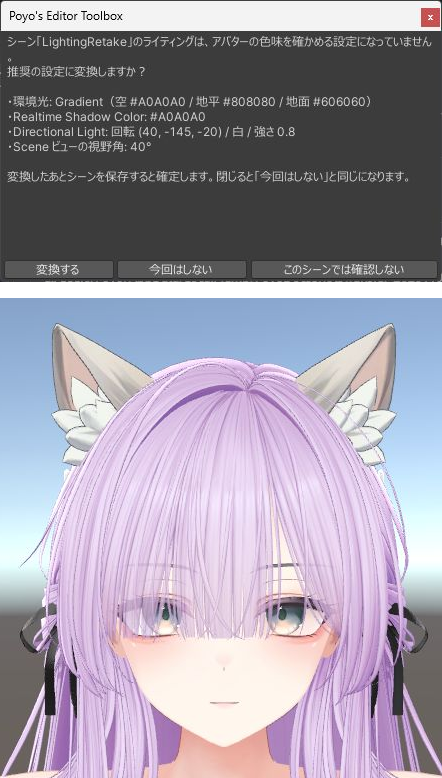

# シーンのライティング

Unity の新しいシーンは、環境光が青寄りで、Directional Light が黄色寄りです。このままアバターの色を合わせると、VRChat のワールドで見たときに黄色っぽく見えます。カメラも既定の視野角では顔がゆがんで見えます。

この機能は、シーンのライティングとカメラを、アバターの色を確かめやすい設定にします。

{ .shot loading=lazy }

## 設定する値

| 対象 | 項目 | 値 |
|---|---|---|
| Lighting > Environment | Environment Lighting の Source | Gradient |
| Lighting > Environment | Sky / Equator / Ground Color | `#A0A0A0` / `#808080` / `#606060` |
| Lighting > Environment | Realtime Shadow Color | `#A0A0A0` |
| Directional Light | Rotation | X 40 / Y -145 / Z -20 |
| Directional Light | Color / Intensity | `#FFFFFF` / 0.8 |
| Scene ビュー | カメラの Field of View | 40 |

Directional Light が無いシーンでは、光源は追加せず、ほかの項目だけを設定します。

## 新しいシーン

`File > New Scene` で作ったシーンは、確認せずにこの設定にします。

## 今あるシーン

この設定になっていないシーンを開くと、確認のウィンドウが出ます。

| ボタン | 動き |
|---|---|
| 変換する | この設定にします。シーンは自動で保存しないので、保存して確定します |
| 今回はしない | Unity を閉じるまで、このシーンでは確認しません |
| このシーンでは確認しない | 次からも、このシーンでは確認しません |

- ウィンドウを × で閉じたときは「今回はしない」と同じです。
- 確認のウィンドウが出ている間も、エディタは操作できます。別のシーンを開くと、前のシーンの確認は消えます。

次のときは確認しません。

- 再生中、ビルド中
- 一度も保存していないシーン
- `Assets/` の外にあるシーン
- シーンを Additive で開いたとき

## メニュー

| メニュー | 動き |
|---|---|
| `Tools > Poyo's Editor Toolbox > Scene Lighting > Convert Active Scene` | 今開いているシーンをこの設定にします |
| `Tools > Poyo's Editor Toolbox > Scene Lighting > Skip This Time` | 「今回はしない」と同じです |
| `Tools > Poyo's Editor Toolbox > Scene Lighting > Don't Ask for This Scene` | 「このシーンでは確認しない」と同じです |

下の 2 つは、確認のウィンドウが出ているときだけ選べます。

Project Settings の「シーンのライティングとカメラを整える」の下にも、「今のシーンに適用」と「確認しないシーンをリセット」のボタンがあります。「確認しないシーンをリセット」は、「このシーンでは確認しない」を選んだシーンの一覧を空にします。

## 元に戻す { #undo }

| 変更 | 戻し方 |
|---|---|
| Directional Light の向き・色・強さ | Undo で戻せます |
| Lighting の環境光と Realtime Shadow Color | Undo では戻せません。Lighting ウィンドウで戻してください |
| Scene ビューの視野角 | Scene ビューの右上のカメラの設定で戻してください |

変換したあとに保存せずにシーンを開き直せば、変換する前に戻ります。
