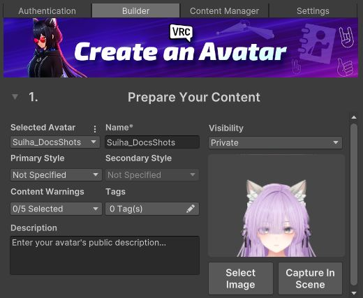

# VRChat SDK への自動入力

初めてアップロードするアバターの名前とサムネイルを、VRChat SDK の画面に入れます。

| 欄 | 入るもの |
|---|---|
| Name | SDK の画面で選んだアバターの、シーンでの名前（GameObject の名前） |
| Thumbnail | そのときの Scene ビューの画像（1200×900） |

{ .shot loading=lazy }

必要なパッケージ: VRChat SDK - Avatars 3.10.0 以上、4.0.0 未満

## 入る条件

SDK の画面（`VRChat SDK > Show Control Panel` の Builder タブ）でアバターを選んだとき、次の両方に当てはまれば入れます。

- 初めてアップロードするアバターであること。Pipeline Manager に Blueprint ID があるアバターでは何もしません。
- 欄が空であること。名前とサムネイルのうち、空の欄だけに入れます。

サムネイルは Scene ビューの見た目のままです。SDK の画面を開く前に、Scene ビューでアバターを撮りたい向きにしておいてください。背景は Scene ビューの表示の設定に従います。気に入らなければ、SDK の画面のサムネイルの欄から撮り直せます。

## 別のアバターに切り替えたとき

SDK は、初めてアップロードするアバターの入力を 1 組しか覚えていません。そのため、アバター A で入れた名前が、続けて選んだアバター B の画面にも残ります。

A のためにこの機能が入れた値がそのまま残っているときは、B の名前と、B を選んだときの Scene ビューの画像に入れ直します。自分で入力した値は、そのままにします。
