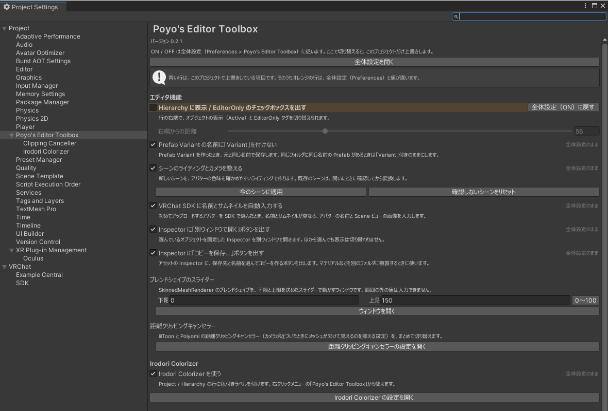

# 設定画面

設定は 2 つのページに分かれています。

| ページ | 内容 | 範囲 |
|---|---|---|
| Preferences の `Poyo's Editor Toolbox`（全体設定） | 機能ごとのオン・オフと、完了通知の設定 | この PC のすべてのプロジェクト |
| Project Settings の `Poyo's Editor Toolbox` | 全体設定をこのプロジェクトだけ変える設定と、プロジェクトごとの値 | このプロジェクト |

ふだんは全体設定でオン・オフを決め、あるプロジェクトだけ変えたいときに Project Settings で変えます。

{ .shot loading=lazy }

チェックを切り替えると、その場で保存して反映します。

## 開き方

| 場所 | 全体設定 | このプロジェクト |
|---|---|---|
| メニュー | `Tools > Poyo's Editor Toolbox > Preferences…` | `Tools > Poyo's Editor Toolbox > Project Settings…` |
| Project ウィンドウか Hierarchy の右クリック | `Poyo's Editor Toolbox > Preferences…` | `Poyo's Editor Toolbox > Project Settings…` |
| Unity の設定画面 | `Edit > Preferences > Poyo's Editor Toolbox` | `Edit > Project Settings > Poyo's Editor Toolbox` |

どちらのページにも、もう一方のページを開くボタンがあります。

## このプロジェクトだけ変える { #override }

Project Settings でチェックを切り替えた項目は、このプロジェクトだけの値（上書き）になります。上書きした項目は、どちらのページでも色が付きます。

| 色 | 内容 |
|---|---|
| なし | 上書きしていません。全体設定に従います。Project Settings の右端に「全体設定のまま」と出ます |
| 青 | 上書きしています。値は全体設定と同じです |
| オレンジ | 上書きしていて、値が全体設定と違います |

- Project Settings では、上書きした行の名前が太字になり、右端に「全体設定（ON）に戻す」か「全体設定（OFF）に戻す」が出ます。押すと上書きをやめ、全体設定に従います。
- Preferences では、上書きした行の右端に「このプロジェクトで上書き中」などと出ます。比べる相手は、今開いているプロジェクトです。
- 全体設定と同じ値にしても、上書きはやめません。やめるのは「全体設定に戻す」を押したときだけです。

## 機能のオン・オフ

| 項目 | 内容 |
|---|---|
| Hierarchy に表示 / EditorOnly のチェックボックスを出す | [Hierarchy のチェックボックス](hierarchy.md) |
| Prefab Variant の名前に「Variant」を付けない | [Prefab Variant の名前](variant.md) |
| シーンのライティングとカメラを整える | [シーンのライティング](scene-lighting.md) |
| VRChat SDK に名前とサムネイルを自動入力する | [VRChat SDK への自動入力](sdk-autofill.md)。VRChat SDK - Avatars 3.10.0 以降が無いときは選べません |
| Inspector に「別ウィンドウで開く」ボタンを出す | [Inspector を別ウィンドウで開く](inspector.md) |
| Inspector に「コピーを保存…」ボタンを出す | [コピーを保存](copy-asset.md) |
| Irodori Colorizer を使う | [Irodori Colorizer](colorizer.md) |

どちらのページの下にも、[完了通知](notifications.md)の設定があります。

## Project Settings だけにある設定

| 項目 | 内容 |
|---|---|
| 右端からの距離 | [Hierarchy のチェックボックス](hierarchy.md)の位置 |
| 今のシーンに適用 / 確認しないシーンをリセット | [シーンのライティング](scene-lighting.md)のボタン |
| 下限 / 上限 | [ブレンドシェイプのスライダー](blendshape-sliders.md)の範囲と、ウィンドウを開くボタン |
| 距離クリッピングキャンセラー | `Poyo's Editor Toolbox` の下の `Clipping Canceller` のページ（[距離クリッピングキャンセラー](clipping-canceller.md)） |
| Irodori Colorizer | `Poyo's Editor Toolbox` の下の `Irodori Colorizer` のページ（[Irodori Colorizer の設定](colorizer-settings.md)） |

## 保存先

| 保存先 | 内容 | 共有 |
|---|---|---|
| Unity のエディタ設定（EditorPrefs） | 全体設定 | この PC のすべてのプロジェクト |
| `ProjectSettings/EditorToolbox.asset` | 上書きしたオン・オフ、確認しないシーン、Hierarchy の位置、スライダーの範囲、距離クリッピングキャンセラーの除外リスト | Git などで共有できます |
| `ProjectSettings/EditorToolbox.IrodoriColorizer.asset` | Irodori Colorizer のラベルと、どこに何色を付けたか | Git などで共有できます |
| `UserSettings/EditorToolbox.asset` | 完了通知の音・Webhook・時間の上書き | 共有しません（Unity の標準の `.gitignore` で除外されます） |

Webhook の URL は、知っている人なら誰でも投稿できてしまいます。このため、URL は全体設定か `UserSettings/` にだけ保存し、`ProjectSettings/` には書きません。`UserSettings/` を Git に入れているときは、除外してください。
