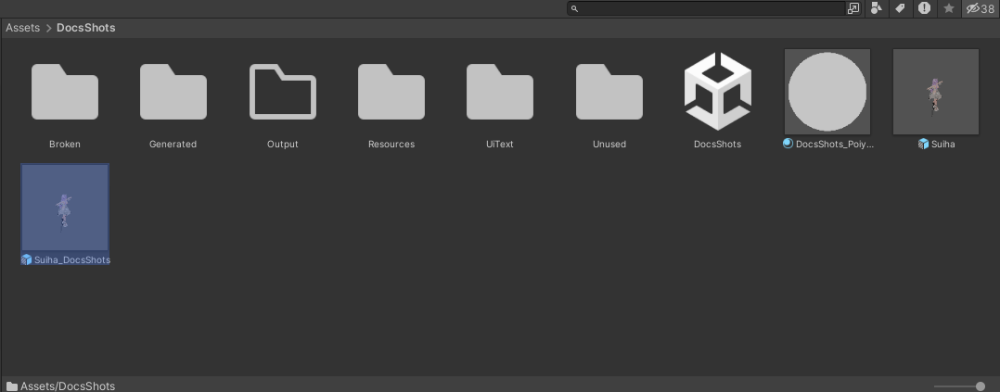

# Prefab Variant の名前

Unity は Prefab Variant を作ると、ファイル名の末尾に ` Variant` を付けます（例: `Suiha Variant.prefab`）。シーンに置いたときの名前もファイル名と同じなので、Hierarchy や VRChat SDK の画面にも「〇〇 Variant」と出ます。

この機能がオンのときは、Variant を作った直後に、名前から ` Variant` を外します。

{ .shot loading=lazy }

## 名前を変える条件

次のすべてに当てはまるときだけ、名前を変えます。

- 新しく作った Prefab Variant であること
- 名前が「元の名前 + ` Variant`」のままであること。作るときに名前を入力したときは変えません
- 同じフォルダに、同じ名前の Prefab が無いこと

`Create > Prefab Variant` は、元の Prefab と同じフォルダに Variant を作ります。元が `Suiha.prefab` のときは、` Variant` を外すと元と同じ名前になるので、`Suiha Variant.prefab` のままにします。

| 元 | 作った場所 | 名前 |
|---|---|---|
| `Suiha.fbx`（モデル） | 同じフォルダ | `Suiha.prefab` |
| `Suiha.prefab` | 同じフォルダ | `Suiha Variant.prefab` のまま |
| `Suiha.prefab` | 別のフォルダ | `Suiha.prefab` |

元と同じ名前にしたいときは、別のフォルダに Variant を作ってください。

名前の変更は Undo で取り消せません。戻したいときは、Project ウィンドウで名前を変えてください。
